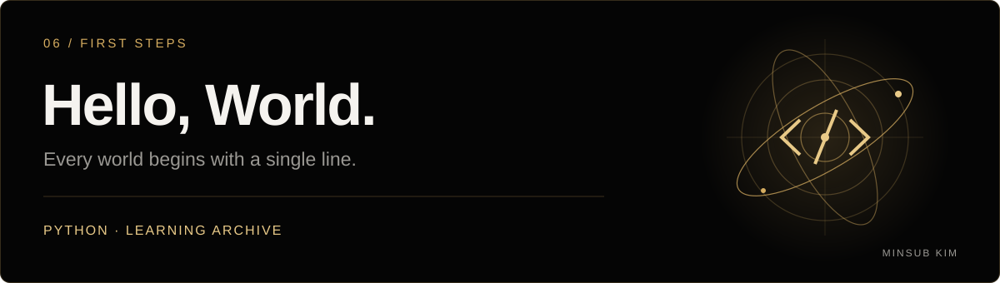

<!-- MINSUB-BRAND:START -->
<p align="center">
  <a href="https://minsub-kim-portfolio.vercel.app/"></a>
</p>
<p align="center">
  <a href="https://minsub-kim-portfolio.vercel.app/"></a>
</p>
<p align="center">
  <a href="https://github.com/minsub1489">개발자 프로필</a> · <a href="https://minsub-kim-portfolio.vercel.app/">포트폴리오</a>
</p>
<!-- MINSUB-BRAND:END -->

---

# Hello, World.

Python으로 Hello World를 출력하는 첫 실습을 보관한 학습 기록입니다.

```python
print("Hello World")
```

## 실행

```sh
python3 "Hello World.py"
```

[실습 소스 보기](Hello%20World.py)
